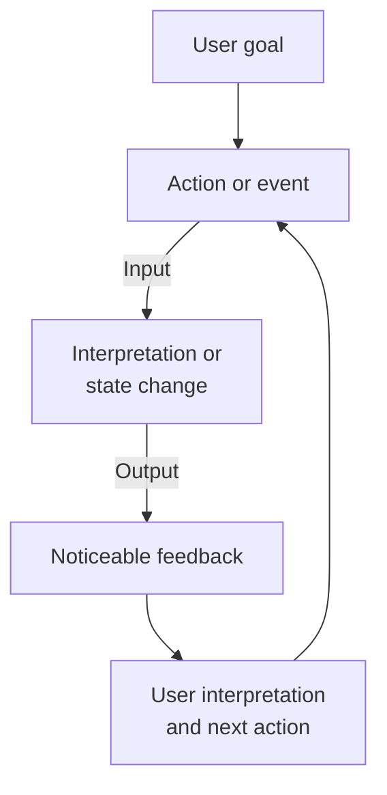

# Session 1 — User Needs and Initial Project Concept

[Course home](../../README.md) · [All sessions](../README.md) · [Glossary](../../resources/glossary.md) · [Readings and references](../../resources/academic-readings.md)

**Duration:** 135 minutes in three 45-minute blocks · **Format:** team work and discussion · **Working language:** English

## Where we are going

Today your team moves from a broad interest to a clear first project idea. This idea is a **hypothesis**: it still needs to be checked with evidence. By the end of the session, you should have a reachable user, a specific context, a problem hypothesis, an intended value, one complete interaction loop, a six-step main scenario, and a rough concept that another team can understand.

## By the end you can

- explain an interactive system as an interaction loop between a person and a system in a real context;
- record team members' interests, contributions, learning goals, availability, and first working agreement;
- identify one primary user, a specific context of use, and a problem or unmet need without jumping directly to a feature;
- write an initial value proposition and identify input, system response or state, output, feedback, and interface;
- represent one main use scenario through a paper- or mock-up-based low-fidelity prototype;
- present the initial concept, give focused peer feedback, and choose one way to collect evidence.

## Before starting

Work in teams of 3–5 students. Have a shared space for notes and simple materials for a low-fidelity prototype. Follow the page in order; open the linked activities when prompted and record results in your team’s workspace.

## Session route

| Focus | Open in class | Team result |
|---|---|---|
| Course project and today's destination | [Project boundaries](#1-course-project-and-boundaries) | Shared destination |
| Interactive systems | [Activity 01](activities/01-interactive-system-think-pair-share.md) | Interaction loops |
| Human-centred design worked example | [Activity 02](activities/02-human-centred-design-worked-example.md) | Example concept chain |
| Team formation | [Activity 03](activities/03-team-formation-and-skills-mapping.md) | Team roster and agreement |
| User, problem, and context | [Activity 04](activities/04-problem-candidates-and-context-scan.md) | Candidate frames and context scans |
| Select one direction | [Activity 05](activities/05-candidate-idea-screen.md) | Decision and reasons |
| Value and interaction loop | [Activity 06](activities/06-value-proposition-and-interaction-loop.md) | Value proposition and loop |
| Scenario and rough concept | [Activity 07](activities/07-main-scenario-and-low-fidelity-concept.md) | Scenario and prototype |
| Pitch and peer feedback | [Activity 08](activities/08-pitch-and-peer-feedback.md) | Feedback notes |
| Exit record | [Activity 09](activities/09-exit-ticket-and-between-session-task.md) | Next step and risks |

## Key terms for today

| Term | Simple meaning |
|---|---|
| **Interactive system** | A system that receives input, changes or responds, and gives output that affects what a person does next |
| **Primary user** | The main person who directly uses or interacts with the system in your scenario |
| **Context of use** | The user, goal, task, place, social situation, tools, and conditions around the interaction |
| **Hypothesis** | An idea or claim that may be true but still needs to be checked |
| **Evidence** | Information from a source, observation, conversation, or test that helps you judge a claim |
| **Input** | An action, signal, or environmental change that enters the system |
| **System state** | What the system currently knows, stores, or treats as true |
| **Output** | What the system produces or changes |
| **Feedback** | Output that helps the user understand what happened or what to do next |
| **Value proposition** | A short claim about how the concept may help a specific user in a specific context |
| **Scenario** | A short story that shows one concrete use from trigger to outcome |
| **Prototype** | A representation made to explore or test a design question; it is not the finished product |
| **Low fidelity** | Deliberately simple and quick to change, for example paper screens or movable cards |

See the [course glossary](../../resources/glossary.md) for more terms and examples.

## Course project and boundaries

The course project is not a race to build a feature. It is a repeated process of learning, designing, testing, and improving. The first concept may be wrong. It only needs to be clear enough to investigate and revise.

For the first project concept:

- work with one real and reachable primary user role in one recognisable situation;
- include at least one meaningful physical or sensed input and one output the user can notice;
- choose a safe interaction that can be acted out and studied during the course, and that is not relied on for health or safety;
- collect no unnecessary personal or sensitive data;
- complete one main interaction from trigger to outcome before adding features;
- label assumptions as assumptions rather than presenting them as user research.

> [!CAUTION]
> At this stage, a statement about a user is a **hypothesis**, meaning an idea that still needs to be checked. **Evidence** is information that helps you judge the idea. Your own experience can inspire a direction, but it does not represent every future user.

## Interactive systems

An interactive system receives input, changes or responds, and produces output. The user notices the feedback, understands something, and decides what to do next.

This includes screen-based products, embedded devices, sensor-based systems, and services that combine human and technical work.

### Interaction model

The **interface** is everything through which the user and system communicate. It can include buttons, screens, sound, light, movement, sensors, and physical objects. Context changes whether the interaction works: lighting, noise, mobility, social expectations, connectivity, time pressure, prior knowledge, and assistive technology can all matter.

### Example: stop request on a city bus

| Element | Example |
|---|---|
| User goal | Leave the bus at the next stop |
| User action | Press the stop button |
| Input | Button-press signal |
| System state | Stop requested for the next stop |
| Output | Audible chime and visible “Stop requested” message |
| Feedback | The passenger can hear or see that the request was registered |
| Next action | The passenger waits near the exit and expects the bus to stop |

A printed bus timetable presents useful information but does not change when a person uses it. A digital journey planner is interactive: a destination or location becomes input, the service calculates a route, and the feedback helps the user choose what to do next.

**Do now:** [Activity 01 - Interactive System Think–Pair–Share](activities/01-interactive-system-think-pair-share.md)

## Human-centred design

Human-centred design is an approach that keeps people, their goals, and their context central throughout development. It is not one single research technique.

- explicitly understand users, goals, tasks, resources, and environments;
- involve users and other relevant people throughout development;
- let evaluation evidence inform design decisions;
- expect understanding, requirements, concepts, and evaluation to inform one another through iteration;
- consider the whole experience, including physical and social conditions;
- combine different forms of expertise.

### Technology-first and human-centred framing

Technology-first statement:

> Let us build something with a CO₂ sensor and LEDs.

Questions still missing:

- Who is the primary user?
- In what situation?
- What are they trying to achieve?
- What currently breaks down?
- What human outcome could improve?
- What interaction connects input, state, output, and feedback?
- Which claims are evidence and which are assumptions?

Human-centred framing begins with these questions and treats the sensor as one possible component, not the purpose of the project.

**Do now:** [Activity 02 - Human-Centred Design Worked Example](activities/02-human-centred-design-worked-example.md)

## Form a project team

A useful project team makes current contributions and learning goals visible without assigning permanent expert roles. Technical experience is one contribution among many. Observation, interviewing, writing, visual explanation, coordination, prototyping, presentation, careful testing, programming, and electronics can all matter.

Teams should have 3–5 members, compatible working times, and a shared interest in at least one user or problem area. The team also needs **psychological safety**: members should feel safe to ask questions, challenge an idea, make a mistake, or admit uncertainty.

Use rotating roles today:

- **facilitator and timekeeper** - keeps attention on the question and invites each voice;
- **recorder** - captures alternatives, decisions, assumptions, and reasons;
- **prototype maker** - turns discussion into movable and testable representations;
- **critical friend** - checks logic, scope, safety, inclusion, and evidence status;
- **presenter** - delivers the pitch and listens during peer feedback.

**Do now:** [Activity 03 - Team Formation and Skills Mapping](activities/03-team-formation-and-skills-mapping.md)

## User, context, problem, and evidence

Do not begin by choosing a gadget. Begin by making the situation specific enough to investigate.

| Concept | Working definition |
|---|---|
| Primary user | The main person who directly interacts with the system in the scenario |
| Context of use | The user's goal and task, the place and social situation, available tools, and other conditions |
| Problem hypothesis | An initial claim about a difficulty or unmet goal, without already choosing a solution |
| Evidence status | What supports the claim, how strong that support is, and what is still only assumed |

### Problem-frame pattern

> In **[specific situation]**, **[specific user]** needs to **[goal]**, but **[present condition or breakdown]** makes this difficult. We currently believe this because of **[named observation, report, experience, or assumption]**.

### Weak and stronger framing

**Weak idea:** Build a smart light for study rooms.

**Working problem hypothesis:** During long group-work sessions in bookable study rooms, students need to maintain a workable environment without interrupting the discussion, but they may notice poor room comfort only after concentration has declined. This is currently a hypothesis based on the team's own experience and must be checked with other students.

**Do now:** [Activity 04 - Problem Candidates and Context Scan](activities/04-problem-candidates-and-context-scan.md)

## Select one working direction

Compare candidates using shared criteria. A number helps make uncertainty visible, but it does not replace judgement. A high total cannot rescue a direction that is unsafe, impossible to investigate, or outside the course scope.

Check:

1. access to a relevant user;
2. a clear and specific context;
3. a useful result for the person;
4. an observable interaction loop;
5. a realistic physical or sensed input and an output the user can notice;
6. feasibility of a minimal complete scenario;
7. ethics, privacy, and safety;
8. team motivation and learning opportunities.

Your checkpoint statement is:

> Our primary user is **[specific role]**. In **[specific context]**, the user needs to **[goal]**, but **[problem or breakdown]**. We can investigate this by **[practical way to collect evidence]**.

**Do now:** [Activity 05 - Candidate Idea Screen](activities/05-candidate-idea-screen.md)

## Value proposition and interaction loop

A value proposition is an initial claim about how the concept may help a specific user in a specific context. Describe what may become better for the person, not how new the technology is or how many features it has.

### Working value proposition

> For **[specific user]** in **[specific context]** who needs to **[goal]**, our concept may help by **[benefit]**, so that **[meaningful outcome]**.

### Minimum system boundary

The **system boundary** separates what the system does from what the user and environment do. It helps the team decide what the first version must include.

Before adding features, connect:

1. user goal;
2. user action or relevant environmental event;
3. input received by the system;
4. interpretation, rule, or state change;
5. output in the physical or digital world;
6. feedback the user can notice and understand;
7. user interpretation and next action.

An output becomes useful feedback only when the user can notice it and understand what it means.

**Do now:** [Activity 06 - Value Proposition and Interaction Loop](activities/06-value-proposition-and-interaction-loop.md)

## Main scenario and low-fidelity concept

A scenario is a short and concrete story of use. It connects the user, setting, goal, actions, system responses, feedback, and outcome. You can change it when you learn something new.

For today, one six-step scenario is enough:

1. trigger and setting;
2. user goal;
3. user action or environmental input;
4. system interpretation or state change;
5. output and feedback;
6. user interpretation and outcome.

### A prototype should answer a question

Your prototype may explore:

| Focus | Design question | Useful representation | Intentionally omit |
|---|---|---|---|
| Role | Does the concept have a useful place in the user's activity? | Act out the scenario or walk through the service | Technical detail that does not affect the role |
| Look and feel | How are action, sequence, feedback, or physical placement experienced? | Paper screens, state cards, or a rough physical arrangement | Backend logic and visual polish |
| Implementation | Is a technical behaviour or system boundary plausible? | Block diagram, simulated input, or isolated technical proof | A complete interface unless the question requires it |

Paper, cards, cardboard, and a person acting as the system are useful when the question is about steps, feedback, meaning, or placement rather than visual finish.

Complete this sentence before making anything:

> This prototype helps us learn whether…

**Do now:** [Activity 07 - Main Use Scenario and Low-Fidelity Concept](activities/07-main-scenario-and-low-fidelity-concept.md)

## Present and receive peer feedback

The pitch should make the initial concept understandable, not sell it as finished. Feedback should show what another team understood, what is unclear, and what you should investigate next.

The presenting team listens and records. It does not defend or redesign the concept during the feedback period. The reviewing team first describes what it understood and only then evaluates it.

Useful feedback begins with:

- I understood the primary user, context, and need as…
- The clearest link in the interaction loop was…
- One point I could not understand was…
- One assumption or risk I noticed is…
- One question the next inquiry or prototype should answer is…
- One specific strength worth retaining is…

**Do now:** [Activity 08 - Pitch and Peer Feedback](activities/08-pitch-and-peer-feedback.md)

## Finish the session

Before leaving, record the largest untested assumption, what you need to learn next, how you will investigate it, who will arrange the activity, and where anonymised evidence will be stored.

**Do now:** [Activity 09 - Exit Ticket and Between-Session Task](activities/09-exit-ticket-and-between-session-task.md)

## Completion evidence

- team roster and working agreement;
- initial and revised user–context–problem statement;
- initial and revised value proposition;
- main use scenario and prototype images;
- anonymised evidence notes;
- three assumptions or risks: user/context, interaction, and feasibility/ethics;
- one sentence stating what the team needs to learn next.

## Next steps

Complete the [between-session evidence task](activities/09-exit-ticket-and-between-session-task.md#between-session-task). Bring the records above to Session 2, preserving the original concept when you revise it.

---

[All sessions](../README.md) · [Next session](../02-interaction-architecture-and-prototyping/README.md) · [Back to session route](#session-route)
