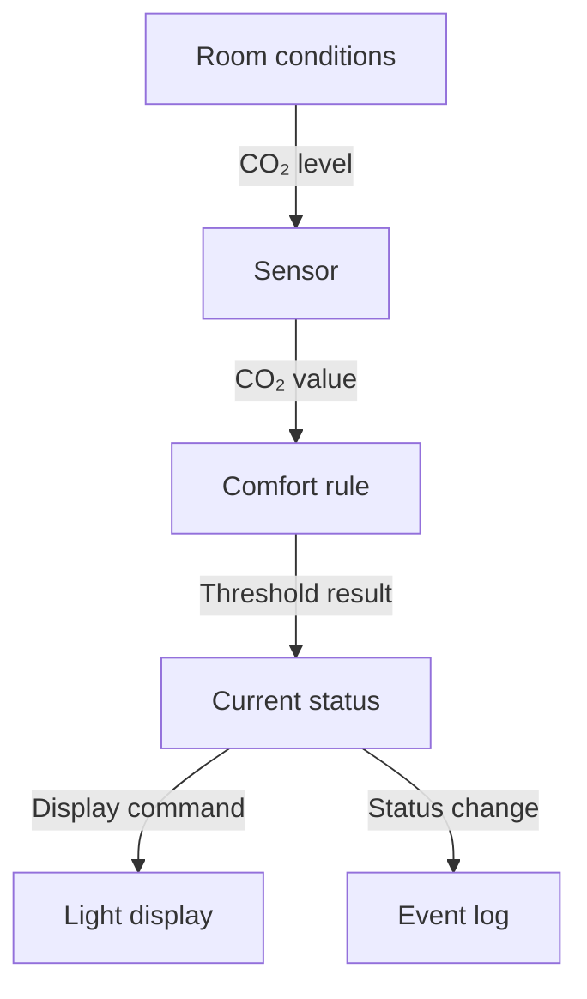
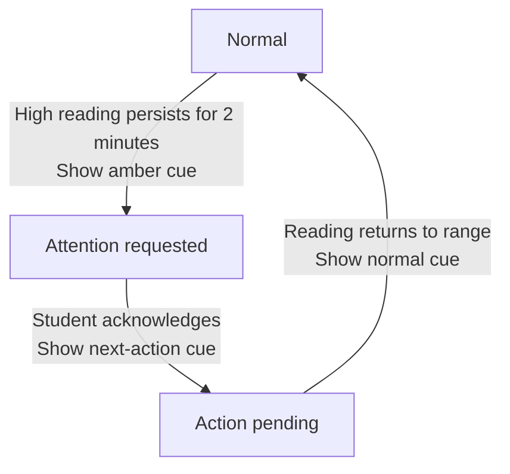

# Session 2 — Interaction, Architecture, and Prototyping

[Course home](../../README.md) · [All sessions](../README.md) · [Glossary](../../resources/glossary.md) · [Readings and references](../../resources/academic-readings.md)

**Duration:** 135 minutes in three 45-minute blocks · **Format:** team modelling and prototyping · **Working language:** English

## Where we are going

Today your team turns the initial concept into two connected models: a **system architecture** and an **interaction flow**. You will use them to decide what the low-fidelity prototype must represent, inspect ergonomic and accessibility risks, and build a testable version without implementing the final technology.

## By the end you can

- identify system components, responsibilities, boundaries, and labelled data flows;
- represent system states, events, transitions, feedback, and meaningful alternative paths;
- use interaction patterns, ergonomic questions, and relevant WCAG 2.2 criteria to find design risks;
- choose prototype fidelity by the question being investigated rather than by visual polish;
- select and justify paper prototyping, a physical mock-up, Wizard-of-Oz, or a hybrid method;
- keep the architecture, interaction flow, and low-fidelity prototype consistent.

## Before starting

Bring the latest concept, user–context–problem statement, value proposition, scenario, prototype image and evidence notes from Session 1. Continue in teams of 3–5 students and keep new decisions in your shared workspace.

## Session route

| Focus | Open in class | Team result |
|---|---|---|
| Reconnect evidence and the concept | [Activity 01](activities/01-evidence-and-concept-reconnect.md) | Current concept and modelling focus |
| System architecture and data flow | [Activity 02](activities/02-system-architecture-and-data-flow.md) | Architecture diagram with labelled flows |
| States and alternative paths | [Activity 03](activities/03-states-and-alternative-interaction-paths.md) | Main path and two alternatives |
| Patterns, ergonomics, and accessibility | [Activity 04](activities/04-patterns-ergonomics-and-accessibility.md) | Inspection record and design changes |
| Prototype fidelity and method | [Activity 05](activities/05-prototype-fidelity-and-method-selection.md) | Prototype decision record |
| Build and walkthrough | [Activity 06](activities/06-build-walkthrough-and-handover.md) | Prototype version 1.1 and walkthrough notes |
| Between-session handover | [Prepare for Session 3](#7-prepare-for-session-3) | Stable test version and two participant tasks |

## Key terms for today

| Term | Simple meaning |
|---|---|
| **System boundary** | The line between what belongs to the system and what belongs to the user, environment, or an external service |
| **Component** | A part with a clear responsibility, such as sensing, deciding, storing, displaying, or acting |
| **Data flow** | An event, value, command, or message moving between parts |
| **State** | A condition the system currently treats as true and that can affect later behaviour |
| **Event** | Something that may trigger a response or transition |
| **Transition** | A change from one state to another after an event or condition |
| **Alternative path** | A route caused by error, delay, cancellation, recovery, or another meaningful condition |
| **Interaction pattern** | A reusable response to a recurring interaction problem in a stated context |
| **Ergonomics** | Designing interaction to fit human capabilities, limitations, tasks, and environments |
| **Accessibility** | Enabling people with diverse abilities and assistive technologies to perceive, operate, and understand the system |
| **Prototype fidelity** | How realistically selected qualities of a design are represented |
| **Wizard-of-Oz** | A prototype in which a person secretly or visibly performs behaviour that a future system may automate |

See the [course glossary](../../resources/glossary.md) for more terms and examples.

## Reconnect evidence and the concept

Bring forward the latest user-context-problem statement, value proposition, main scenario, prototype image, and evidence notes from Session 1. Do not treat the earlier concept as fixed. Evidence may support it, narrow it, or show that it needs revision.

Before drawing architecture, agree on one sentence:

> In this session we need to make **[uncertain interaction or system behaviour]** clear enough to inspect and prototype.

**Do now:** [Activity 01 - Evidence and Concept Reconnect](activities/01-evidence-and-concept-reconnect.md)

## Model the system architecture

An architecture description is a model made for a purpose. Today the purpose is to make the proposed interaction understandable and testable. The diagram is not a complete technical specification.

Use these parts when they matter:

| Part | Question |
|---|---|
| User and environment | Who or what initiates change, and under which conditions? |
| Interface | Where can the user act or perceive feedback? |
| Input | Which event or value enters the system? |
| Processing or control | What rule, comparison, transformation, or decision occurs? |
| State or stored data | What must the system remember or treat as currently true? |
| Output | What command, display, sound, movement, or other change is produced? |
| External service | Does the concept depend on another device, network, API, person, or organisation? |

Draw arrows only when something crosses from one part to another. Label the thing that flows, such as `button event`, `sensor value`, `current state`, `status message`, or `actuator command`. An unlabeled line hides the exact dependency.

Keep three distinctions visible:

- a **component** has a responsibility;
- a **flow** carries an event, value, command, or message;
- a **state** records a condition that can affect later behaviour.

### Running example: shared study-room comfort cue

The arrow labels should name what moves: `CO₂ value`, `threshold result`, `current status`, and `display command`. The room and students are outside the system boundary; the sensor, rule, stored status, and light display are inside it. This is one possible model, not a required solution for your project.

**Do now:** [Activity 02 - System Architecture and Data Flow](activities/02-system-architecture-and-data-flow.md)

### Public learning sources

- [ISO/IEC/IEEE 42010:2022 official overview](https://www.iso.org/standard/74393.html)
- [Fielding (2000), open chapter on software architecture](https://ics.uci.edu/~fielding/pubs/dissertation/software_arch.htm)

## Model states and alternative interaction paths

A flow shows movement through the system. A state model shows what the system currently treats as true and what event can change it.

Write every transition in this form:

**Current state** + **event or condition** → **system action and feedback** → **next state**.

For the running example:

For the main scenario, show the expected path from trigger to outcome. Then add at least two alternatives that matter to the user. Useful alternatives include:

- missing, delayed, or implausible input;
- repeated input or an accidental action;
- a user who does not notice or understand the first feedback;
- loss of power, connection, or an external service;
- cancellation, reversal, timeout, recovery, or safe default;
- two people acting at nearly the same time.

Do not add every imaginable failure. Choose alternatives that could change the design or the prototype question.

**Do now:** [Activity 03 - States and Alternative Interaction Paths](activities/03-states-and-alternative-interaction-paths.md)

### Public learning sources

- [Harel (1987), open university-hosted PDF](https://www.csd.uoc.gr/~hy565/docs/pdfs/papers/statecharts_visual_formalism.pdf)
- [MIT, open reading on input events and state machines](https://web.mit.edu/6.813/www/sp17/classes/12-input/)

## Check patterns, ergonomics, and accessibility

An interaction pattern is a reusable response to a recurring user problem. A pattern is not a decoration or a rule that fits every context. State the user problem, the proposed response, and why it fits this situation.

Examples include visible system status, confirmation before a high-cost action, undo or recovery, consistent control-response mapping, progressive disclosure, redundant feedback, and safe defaults. Use a pattern only when the problem and consequences are clear.

### Ergonomic questions

- Can the intended user perceive the signal in the actual lighting, noise, distance, posture, and social setting?
- Can the user reach, distinguish, and operate the control with realistic movement and precision?
- Does the control-response mapping match likely expectations?
- Can the user control the pace, stop, reverse, or recover where needed?
- Does the design prevent or tolerate predictable use errors?
- Is the feedback timely, specific, and proportional to the importance of the event?

### Accessibility questions

WCAG 2.2 applies to web content. Use its principles and relevant success criteria directly for a web interface. For a physical prototype, use them as design questions rather than claiming formal WCAG conformance.

- **Perceivable:** Is important meaning available without relying only on colour, sound, shape, or location?
- **Operable:** Is there an alternative to precise pointing, dragging, sustained movement, or one specific physical action?
- **Understandable:** Are labels, status changes, instructions, and errors clear and consistent?
- **Robust:** Can software controls expose a meaningful name, role, value, and state to assistive technology?

For the first review, inspect at least these WCAG 2.2 criteria when relevant: 1.4.1 Use of Color, 1.4.3 Contrast Minimum, 1.4.11 Non-text Contrast, 2.1.1 Keyboard, 2.4.7 Focus Visible, 2.5.8 Target Size Minimum, 3.3.1 Error Identification, 3.3.2 Labels or Instructions, 4.1.2 Name Role Value, and 4.1.3 Status Messages.

For the study-room cue, colour alone would be insufficient. A redundant signal could combine colour with a readable word, distinct light behaviour, or another perceivable cue. The useful choice depends on distance, lighting, noise, attention, and the needs of actual users.

**Do now:** [Activity 04 - Patterns, Ergonomics, and Accessibility](activities/04-patterns-ergonomics-and-accessibility.md)

### Public learning sources

- [ISO 9241-110:2020 official overview](https://www.iso.org/standard/75258.html)
- [ISO 9241-171:2025 official overview](https://www.iso.org/standard/86308.html)
- [W3C Web Content Accessibility Guidelines 2.2](https://www.w3.org/TR/WCAG22/)
- [van Welie and Trætteberg (2000), Interaction Patterns in User Interfaces](https://www.welie.com/papers/PLoP2k-Welie.pdf)

## Choose prototype fidelity and method

Fidelity is not one scale from bad to good. A prototype can be detailed in one respect and deliberately rough in another. Select the qualities needed to answer the prototype question.

| Method | Useful when the question concerns | Main caution |
|---|---|---|
| Paper interface | sequence, labels, navigation, feedback, alternatives, or screen states | a person must change the interface consistently |
| Physical mock-up | placement, reach, size, orientation, mapping, visibility, or multimodal feedback | do not let material finish replace behavioural testing |
| Wizard-of-Oz | behaviour that is expensive or impossible to automate yet | define the operator script, timing, limits, and disclosure or debrief plan |
| Hybrid | a connected physical and digital interaction | keep one shared state model so the parts do not contradict each other |

High-fidelity prototypes become useful when the question depends on realistic timing, sensory qualities, device behaviour, visual detail, data handling, or technical integration. They also cost more to change and can make an unfinished concept appear settled. Use only the fidelity needed for the present question.

**Do now:** [Activity 05 - Prototype Fidelity and Method Selection](activities/05-prototype-fidelity-and-method-selection.md)

### Public learning sources

- [Houde and Hill (1997), What Do Prototypes Prototype?](https://hci.stanford.edu/courses/cs247/2012/readings/WhatDoPrototypesPrototype.pdf)
- [Lim, Stolterman, and Tenenberg (2008), The Anatomy of Prototypes](https://faculty.washington.edu/jtenenbg/publications/limAnatomyOfPrototypes-tochi2008.pdf)
- [Virzi, Sokolov, and Karis (1996), free ACM full text](https://doi.org/10.1145/238386.238516)
- [Walker, Takayama, and Landay (2002), author-hosted paper](https://www.leilatakayama.org/downloads/Takayama.Prototypes_HFES2002_prepress.pdf)
- [Porcheron, Fischer, and Reeves (2020), open author-hosted paper on Wizard-of-Oz practice](https://people.cs.nott.ac.uk/pszsr/files/porcheron-2020-wizard-of-oz.pdf)

## Build and walk through the prototype

Build only the states, controls, outputs, and alternative paths required by the question. The prototype, architecture, and interaction flow must describe the same system.

Before the walkthrough, assign roles:

- one person is the participant;
- one person operates any simulated system behaviour;
- one person records actions, hesitation, interpretation, and mismatches;
- remaining team members observe silently.

During the walkthrough, do not teach the interface. Give the scenario and goal, then let the participant act. Record what happened before discussing changes.

**Do now:** [Activity 06 - Build, Walkthrough, and Handover](activities/06-build-walkthrough-and-handover.md)

## Completion evidence

Keep these records and complete the handover before the next meeting:

- architecture and labelled data-flow diagram version 1;
- main and alternative interaction paths;
- accessibility and ergonomics review with resulting changes;
- prototype decision record and prototype version 1.1;
- one research question and two task scenarios;
- operator script if the prototype uses Wizard-of-Oz behaviour;
- a list of assumptions, known limitations, and questions that remain.

## Next steps

Between sessions, finish one testable low-fidelity version. Keep the architecture, state model, and prototype consistent. Write one research question and two realistic participant tasks for the next meeting.

---

[Previous session](../01-user-needs-and-initial-project-concept/README.md) · [All sessions](../README.md) · [Next session](../03-wizard-of-oz-and-arduino-prototyping/README.md) · [Back to session route](#session-route)
