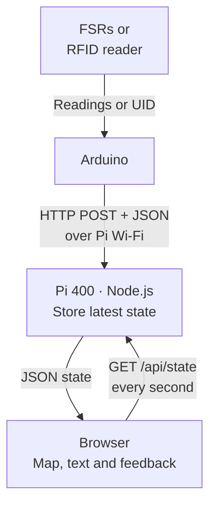

# Session 4 — Integration and Collaborative Development

[Course home](../../README.md) · [All sessions](../README.md) · [Glossary](../../resources/glossary.md) · [Readings and references](../../resources/academic-readings.md)

**Duration:** 135 minutes in three 45-minute blocks · **Format:** team build and integration · **Working language:** English

## Where we are going

Build your selected Hi-Fi slice as one integrated system. Each group uses its own independent server, page and Arduino examples. Get your group’s supplied example working first, then change one meaningful feature. The display is a browser on the Pi monitor or a computer connected to its Wi-Fi; no Arduino screen module is required.

- Group 1: two FSRs → one UNO R4 WiFi → Pi 400 → library plan with two seats.
- Group 2: RFID-RC522 V1.33 with AMRFID → UNO R4 WiFi → Pi 400 → hall plan with seat and route for 2–3 tickets.

Both Pi hotspots use **Wi-Fi security: OPEN** (no password). Their SSIDs are `IFI7386-G1` and `IFI7386-G2`. The Arduino network sketches and Wi-Fi check connect using the SSID only.

## By the end you can

- trace physical input through firmware, HTTP and JSON to visible feedback;
- agree a data contract and distinguish valid, waiting, unknown and error states;
- integrate contributions across the hardware, server and interface layers;
- demonstrate the main interaction, failure and recovery.

## Before starting

Bring the Hi-Fi build decision from Session 3 and the parts for your group’s circuit. Start with the serial-only sketch and reliable local input before adding the Pi or Wi-Fi. Use the [group guides](#open-in-order) and the prepared Pi setup.

## Session route

| Focus | Open in class | Team result |
|---|---|---|
| Recall the selected interaction and upload procedure | [Code guide](code-guide.md) | Explain input → Arduino rule → Serial Monitor. |
| Wire with power disconnected; upload the serial-only sketch | [Group 1](group-1-library.md) or [Group 2](group-2-ticket.md), Stage 1 | Actual FSR readings or real RFID UIDs in Serial Monitor. |
| Calibrate both chairs or collect 2–3 UIDs; repeat the local interaction | Your group guide, Stage 1 | C1: reliable local data and saved thresholds/UIDs. |
| Turn measured values into a message; assign layer/file owners | [Data contract](data-contract.md) | Explain the contract using your measurements. |
| Join the prepared hotspot; start host; upload network sketch | [Pi setup](setup.md), then your group guide, Stage 2 | C2: real Arduino data reaches Pi; HTTP 200. |
| Open browser; check seats/routes and real UID mappings | Your group guide, Stage 2 | C3: physical input changes the correct feedback. |
| Read the code and make one useful change | [Code guide](code-guide.md) | Explain the changed variable/function and result. |
| Run acceptance and recovery checks | [Tests and handover](testing.md) | Pass/fail evidence and one issue addressed. |
| Demonstrate, receive peer feedback and save the handover | [Tests and handover](testing.md) | Working slice, limitations and next step. |

If breaks must fit inside the slot, take them from optional modification time. Drop extension work first if behind schedule. A team using simulation must label integration unfinished.

## Key terms for today

| Term | Simple meaning |
|---|---|
| **Firmware** | The program running on Arduino; the host and browser run separate code. |
| **Data contract** | Agreed message fields, types, IDs and meanings between components. |
| **Snapshot** | A report of current state, such as both chair readings. |
| **Heartbeat** | A repeated message showing communication, not proof that every sensor works. |
| **Stale data** | Information too old to treat as the current state. |
| **Integration test** | A check that connected components produce the intended feedback. |

See the [course glossary](../../resources/glossary.md) for more terms and examples.

## Open in order

1. [How to read the beginner examples](code-guide.md).
2. **Arduino first:** [Group 1: library chairs](group-1-library.md) OR [Group 2: ticket guidance](group-2-ticket.md). Complete Stage 1 without Pi/Wi-Fi.
3. **Only after C1:** [Data contract](data-contract.md), then [Pi setup and transmission](setup.md).
4. **After HTTP 200:** open the browser and finish Stage 2 in your group guide.
5. [Acceptance tests and handover](testing.md).

[Group 1 application](examples/group-1-library/README.md) · [Group 2 application](examples/group-2-ticket/README.md) · [Verification and sources](verification.md)

If Arduino cannot join the Pi hotspot, including when a phone connects, use [Wi-Fi connection diagnosis](wifi-troubleshooting.md) before proceeding to the server. It includes a separate sensor-free sketch and the evidence needed to identify the failing step.

## Explain the complete loop

Arduino is a client; Pi is access point and web server. The browser polls the Pi, not Arduino. Seats use repeated snapshots; tickets use events and reader heartbeats. Expect a few seconds of latency. State resets when the server restarts. Routes start at one fixed entrance; this is not live indoor positioning.

## Collaborative development

During Stage 1, everyone participates in wiring, reading or recording actual sensor data; nobody starts on the host yet. After C1, the hardware/firmware owner preserves the working sensor code, the host/UI owner starts the prepared Pi server, and the integration/test owner maintains IDs and records checkpoints. Simulation is an optional fault-isolation tool after local sensing, not the first activity. In larger teams pair within roles; rotate who explains each layer. Agree field names before combining changes. Give different members ownership of firmware, server/mapping, and interface files. Keep a known working copy and integrate one change at a time. Log time, change, expected result, actual result and next action.

## Completion evidence

- Group 1: both chairs work independently, thresholds come from measurements and missing data becomes unknown.
- Group 2: two real tags select distinct seats, unknown tickets give feedback and old guidance disappears.
- Both teams: explain a request, show recovery and save pass/fail evidence.

## Next steps

After the core works, choose one improvement: clearer map/labels, better FSR thresholds, a third ticket or improved route wording. Keep databases, booking, accounts and automatic routing for later. Before the next meeting save the code, wiring photo, measured thresholds or UID mapping, test log, short demonstration and one usability question.

---

[Previous session](../03-wizard-of-oz-and-arduino-prototyping/README.md) · [All sessions](../README.md) · [Next session](../05-ai-assisted-development-and-git-workflow/README.md) · [Back to session route](#session-route)
