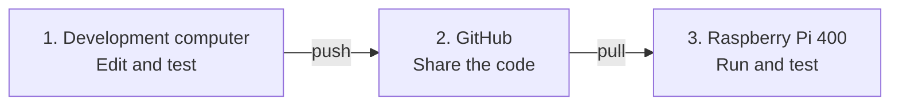

# Session 5 — AI-Assisted Development and the Git Workflow

[Course home](../../README.md) · [Sessions](../README.md) · [Previous session](../04-integration-and-collaborative-development/README.md)

**135 minutes in three 45-minute blocks · Practical group work · Working language: English**

Develop your existing group project with an AI agent, then deliver and test the change on your Raspberry Pi 400. Use your own group GitHub repository and two local Git copies: one on a development computer and one on the Pi. The examples use **Google Antigravity's graphical desktop app** on the development computer. Another AI development tool is acceptable if you can show the same workflow.

Complete the loop twice: first for a small interface improvement, then for a small server improvement. Your group chooses what needs improving and writes the success conditions. The agent helps implement the change; your group reviews and tests it.

## By the end you can

- create a group repository containing your existing server, interface and Arduino sketches;
- distinguish the development copy, GitHub repository and Pi test copy;
- turn an observed problem into a bounded agent prompt and an observable test;
- inspect an agent's changes and check the result locally;
- commit and push a reviewed change, pull it on the Pi, restart and test it;
- switch the Pi between **TLU for GitHub access** and **your group hotspot for Arduino testing**, using the desktop Wi-Fi controls;
- identify the tested version and explain what remains unverified.

## How your change reaches the Pi

Work on your classroom computer or laptop. Share the code through GitHub, then download it on the Pi for testing.

1. **Develop on your computer.** Use Antigravity to change the code. Review and test the result, then **commit** to save a local version.
2. **Share through GitHub.** **Push** uploads your commits to the group's repository. Other computers can now download them.
3. **Test on the Pi.** Connect the Pi to **TLU** and **pull** to download the change. Restore the group **hotspot**, restart the server and test with the real Arduino. Keep code edits on the development computer.

**First setup:** use **clone** once on each computer to create its local Git copy. After that, repeat the three steps above for each change.

**Arduino:** the board sends sensor readings or ticket scans to the Pi during the test. Downloading code onto the Pi does not upload firmware to the board; that is a separate USB upload from the development computer.

## The Pi has two Wi-Fi modes

Work at the Pi's own keyboard and monitor. There is **no Ethernet internet connection** in this lesson.

| Pi Wi-Fi mode | Use it for | What to expect |
|---|---|---|
| Connected to the open network **TLU** | Clone or pull from GitHub | The group hotspot is off; Arduino cannot send to it. |
| Hosting **IFI7386-G1** or **IFI7386-G2** | Run and test the integrated prototype | Internet access is not expected; GitHub updates wait until you switch back to TLU. |

Change modes in the **desktop Wi-Fi menu**. Reactivate the existing group hotspot profile, `ifi-lab`, with the same OPEN security, SSID and `10.42.0.1` address from Session 4. Do not change Arduino's SSID to TLU. The development computer can remain on its internet connection; use the Pi browser for the hardware test. See the [update sequence](activities/04-publish-update-and-test.md).

## Session route

| Minutes | Activity | Checkpoint |
|---|---|---|
| 0–10 | Recall the working Session 4 prototype; instructor demonstrates the loop and Wi-Fi switch | Name the three code locations and record the starting behaviour. |
| 10–35 | [01 — Group repository and two clones](activities/01-team-repository-and-two-clones.md) | C1: own repository, development clone, Pi clone and working baseline. |
| 35–45 | [02 — Find and specify improvements](activities/02-find-and-specify-improvements.md) | Choose one interface issue and one server issue with success conditions. |
| 45–65 | [03 — Develop with Antigravity](activities/03-develop-with-antigravity.md), round 1: interface | Review the change and test it on the development computer. |
| 65–80 | [04 — Publish, update and test](activities/04-publish-update-and-test.md), round 1 | C2: push → Pi on TLU → pull → hotspot → restart → physical test. |
| 80–90 | Record the result, explain the changed code and rotate roles | Buffer for setup or a short break if needed; keep the next change small. |
| 90–110 | [03 — Develop with Antigravity](activities/03-develop-with-antigravity.md), round 2: server | A different member drives; review and test the server change. |
| 110–125 | [04 — Publish, update and test](activities/04-publish-update-and-test.md), round 2 | C3: repeat the complete delivery loop and record the tested commit. |
| 125–135 | [05 — Demonstrate and hand over](activities/05-demonstrate-and-handover.md) | Show both changes, evidence and one remaining issue. |

## How to work together

Use a **driver**, a **reviewer** and a **Pi/test owner**; larger teams can add an observer and recorder. Rotate the driver after the first loop. The reviewer checks that the agent solved the chosen problem and preserved the existing interaction. The Pi owner records network mode, version and test result.

For this exercise, use one shared `main` branch and one active writer at a time. Other members may clone and read the repository. Before a new writer starts, finish the previous push and pull the latest version on the new writer's development computer. Branches and pull requests can be introduced later.

## Completion evidence

Save the repository URL, the two prompts, the before/after observations and one test record per loop. Each record names the commit, Pi network switches, expected result, actual result and whether real hardware or simulation was used. At least one interface improvement and one server improvement must reach and be tested on the Pi. A local-only change is unfinished delivery.

[Instructor preparation and sources](instructor-notes.md)
