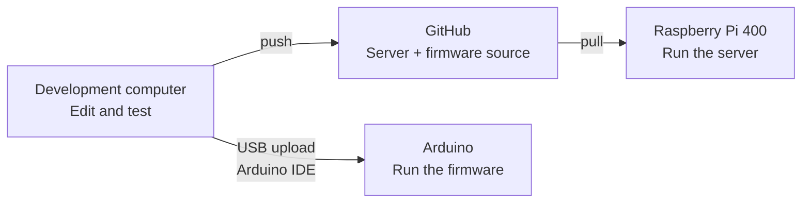

# Session 5 — AI-Assisted Development and the Git Workflow

[Course home](../../README.md) · [Sessions](../README.md) · [Previous session](../04-integration-and-collaborative-development/README.md) · [Next session plan](../06-peer-testing-documentation-and-defence/README.md)

**135 minutes in three 45-minute blocks · Practical group work · Working language: English**

Develop your existing group project with an AI agent, then deliver and test the change on your Raspberry Pi 400. Use your own group GitHub repository and two local Git copies: one on a development computer and one on the Pi. The examples use **Google Antigravity's graphical desktop app** on the development computer. Another AI development tool is acceptable if you can show the same workflow.

Complete the loop twice: first for a small interface improvement, then for a small server improvement. Your group chooses what needs improving and writes the success conditions. The agent helps implement the change; your group reviews and tests it.

## Before starting

Follow [Activity 01](activities/01-team-repository-and-two-clones.md) from the beginning. It now includes **creating a free GitHub account, installing Git, setting the commit author and signing Git into GitHub**, followed by both clones. Prepare the account and software before class where possible.

The recommended Windows route uses **Git for Windows + its included Git Credential Manager + HTTPS browser sign-in**. For the Pi, use a public group repository so download-only access needs no GitHub login. The [Pi instructions](activities/01-team-repository-and-two-clones.md#4-clone-on-the-pi-400) include `git --version` and installation if Git is missing. An alternative for a Mac/Linux development laptop is included in the same activity.

## By the end you can

- create a group repository containing your existing server, interface and Arduino sketches;
- distinguish the development copy, GitHub repository and Pi test copy;
- turn an observed problem into a bounded agent prompt and an observable test;
- inspect an agent's changes and check the result locally;
- commit and push a reviewed change, pull it on the Pi, restart and test it;
- explain how Arduino firmware source is shared through GitHub and uploaded to the board over USB from the development computer;
- switch the Pi between **TLU for GitHub access** and **your group hotspot for Arduino testing**, using the desktop Wi-Fi controls;
- identify the tested version and explain what remains unverified.

## How your change reaches the Pi

Edit both server code and Arduino firmware on your classroom computer or laptop. Keep both in the same group GitHub repository. The two devices receive their updates in different ways:

1. **Develop on your computer.** Use Antigravity to change the code. Review and test the result, then **commit** to save a local version.
2. **Share through GitHub.** **Push** uploads your commits to the group's repository, including any changed `.ino` firmware files. Other development computers can **pull** this source before continuing the work.
3. **Update the device you changed.** For server/interface changes, connect the Pi to **TLU**, **pull**, restore the group **hotspot** and restart the server. For firmware changes, use **Arduino IDE on the development computer** to upload the committed sketch to the Arduino over **USB**. Then test the physical interaction with the Pi server.

**First setup:** use **clone** once on each computer to create its local Git copy. After that, repeat the three steps above for each change.

**Firmware example:** add a version message such as `Library firmware v2` to the regular Serial output in `library/library.ino`, review and compile it, commit and push the source, then upload that same version from the development computer using Arduino IDE. Check the new message alongside the readings in Serial Monitor. Group 2 can print a version message when reading a tag in `ticket/ticket.ino`. See the [firmware update steps](activities/04-publish-update-and-test.md#optional-example-update-arduino-firmware).

The Arduino sends readings or ticket scans to the Pi over Wi-Fi during testing. That data connection does not install firmware. Pulling the repository on the Pi downloads the `.ino` source too, but the board keeps running its previous firmware until a USB upload succeeds.

The two required development rounds below focus on the interface and server. The firmware path is an optional example or instructor demonstration; it does not add a third required round.

## The Pi has two Wi-Fi modes

Work at the Pi's own keyboard and monitor. There is **no Ethernet internet connection** in this lesson.

| Pi Wi-Fi mode | Use it for | What to expect |
|---|---|---|
| Connected to the open network **TLU** | Clone or pull from GitHub | The group hotspot is off; Arduino cannot send to it. |
| Hosting **IFI7386-G1** or **IFI7386-G2** | Run and test the integrated prototype | Internet access is not expected; GitHub updates wait until you switch back to TLU. |

Change modes in the **desktop Wi-Fi menu**. Reactivate the existing group hotspot profile, `ifi-lab`, with the same OPEN security, SSID and `10.42.0.1` address from Session 4. Do not change Arduino's SSID to TLU. The development computer can remain on its internet connection; use the Pi browser for the hardware test. See the [update sequence](activities/04-publish-update-and-test.md).

## Session route

| Activity | Checkpoint |
|---|---|
| Recall the working Session 4 prototype; instructor demonstrates the loop and Wi-Fi switch | Name the three code locations and record the starting behaviour. |
| [01 — Group repository and two clones](activities/01-team-repository-and-two-clones.md) | C1: own repository, working development Git sign-in, Git on the Pi, both clones and a working baseline. |
| [02 — Find and specify improvements](activities/02-find-and-specify-improvements.md) | Choose one interface issue and one server issue with success conditions. |
| [03 — Develop with Antigravity](activities/03-develop-with-antigravity.md), round 1: interface | Review the change and test it on the development computer. |
| [04 — Publish, update and test](activities/04-publish-update-and-test.md), round 1 | C2: publish, update the Pi and test with physical input. |
| Record the result, explain the changed code and rotate roles | Keep the next change small; take a short break if needed. |
| [03 — Develop with Antigravity](activities/03-develop-with-antigravity.md), round 2: server | A different member drives; review and test the server change. |
| [04 — Publish, update and test](activities/04-publish-update-and-test.md), round 2 | C3: repeat the complete delivery loop and record the tested commit. |
| [05 — Demonstrate and hand over](activities/05-demonstrate-and-handover.md) | Show both changes, evidence and one remaining issue. |

## How to work together

Use a **driver**, a **reviewer** and a **Pi/test owner**; larger teams can add an observer and recorder. Rotate the driver after the first loop. The reviewer checks that the agent solved the chosen problem and preserved the existing interaction. The Pi owner records network mode, version and test result.

For this exercise, use one shared `main` branch and one active writer at a time. Other members may clone and read the repository. Before a new writer starts, finish the previous push and pull the latest version on the new writer's development computer. Branches and pull requests can be introduced later.

## Completion evidence

Save the repository URL, the two prompts, the before/after observations and one test record per loop. Each record names the commit, Pi network switches, expected result, actual result and whether real hardware or simulation was used. At least one interface improvement and one server improvement must reach and be tested on the Pi. A local-only change is unfinished delivery.

If you also change firmware, record the source commit uploaded to the Arduino and its USB upload/test result separately from the server version running on the Pi.
