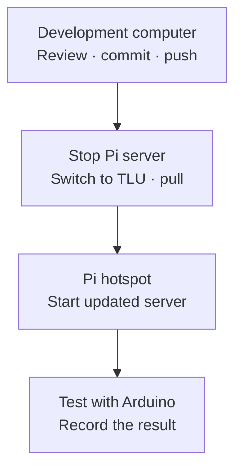

# Activity 04 — Publish, Update and Test

[Session 5](../README.md) · [Development activity](03-develop-with-antigravity.md) · [Final handover](05-demonstrate-and-handover.md)

**Time: about 15 minutes per round · Repeat after each reviewed change**



## 1. Commit and push on the development computer

The [author and browser sign-in setup](01-team-repository-and-two-clones.md#3-clone-on-the-development-computer) should already be complete. If committing reports an unknown author, fix the local name/email settings; if pushing reports an authentication error, repeat the sign-in check. They are different problems.

In Antigravity's **Review** pane, select the files that belong to the completed change and stage them. Choose **Commit**, write a short message describing the result, then choose **Push**. Check that the destination is your group's `origin/main`. If a different branch is selected, stop and agree the branch with the instructor before delivery. [Antigravity commit and push](https://antigravity.google/docs/review-changes/).

If your desktop version has different Git controls, its integrated terminal can do the same work from the project root. Inspect the list, then stage only the files belonging to this change; adjust the paths below if other files were intentionally changed:

```bash
git status
git diff
git add host/index.html host/server.js host/test.js
git commit -m "Describe the improvement"
git push origin main
git rev-parse --short HEAD
```

Use either the graphical commit/push or the terminal alternative. Open the group repository on GitHub and check that your new commit and files are there. Record its short commit ID; **a local commit alone is not delivered**.

## 2. On the Pi, stop and switch to TLU

At the Pi's own keyboard and monitor:

1. Stop the running Node server with **Ctrl+C** in its terminal.
2. Open the desktop's **Wi-Fi menu** and select the open network **TLU**. If the active hotspot must be disconnected first, use its disconnect action, then select TLU.
3. Check internet access by opening your GitHub repository in the Pi browser. Complete a network sign-in page if it appears.

While the Pi uses TLU, its group hotspot is unavailable. Arduino disconnecting at this point is expected. Do not change its firmware or Wi-Fi name to compensate.

## 3. Pull the reviewed version on the Pi

In the Pi terminal, from the existing clone:

```bash
cd ~/team-project
git status --short --branch
git pull --ff-only origin main
git rev-parse --short HEAD
```

Before pulling, the Pi copy should have no local file modifications. If it has any, stop and ask the instructor to help preserve and reconcile them. Do not overwrite them blindly. If pull reports a conflict or cannot fast-forward, resolve the reason before proceeding.

Compare the final commit ID with GitHub and the development copy. If it differs, check the repository URL, branch and push result. If Git says `Already up to date` but the change is missing, check these before editing anything on the Pi.

## 4. Return the Pi to the group hotspot

Use the **desktop Wi-Fi controls** again. Open the hotspot action, commonly under **Advanced Options → Create Wireless Hotspot**, and select/reactivate the **existing `ifi-lab` connection** for your group when offered. Menu wording varies with the installed desktop; the instructor demonstrates the saved-profile selection before the exercise. This step reuses the Session 4 profile rather than creating a new hotspot with different defaults.

Check that the Pi is now **hosting** the expected OPEN network, `IFI7386-G1` or `IFI7386-G2`, with hotspot address `10.42.0.1`. A phone or laptop should see that SSID. If the menu only offers a new hotspot, ask the instructor to restore the saved profile; do not accept an automatically generated password or changed address.

TLU should no longer be the active Wi-Fi connection. Stay in hotspot mode for the hardware test even though internet access is unavailable. Network changes are made through the GUI in this activity. [Raspberry Pi desktop networking](https://www.raspberrypi.com/documentation/computers/configuration.html#wireless-connection).

## 5. Start the updated server and test

From the Pi project root:

```bash
node host/server.js
```

Keep the terminal open. In the **Pi browser**, open **http://localhost:3000** and reload the page. A separate device must join the group hotspot and use **http://10.42.0.1:3000**. On separate Pis, both groups can use port 3000. If using the optional shared-Pi arrangement, keep the group-specific ports from [Session 4 setup](../../04-integration-and-collaborative-development/setup.md#optional-both-servers-on-one-computerpi).

Allow Arduino time to reconnect to the restored hotspot. Check its IP/HTTP 200 output. If it does not recover, reset it and use the [existing Wi-Fi diagnosis](../../04-integration-and-collaborative-development/wifi-troubleshooting.md). The server starts with empty in-memory state: wait for fresh seat messages or rescan a ticket.

Perform the change card's acceptance checks and one original main-path test with the physical input. Also test a relevant failure/recovery: for example unplug/reconnect the board, scan an unknown card, or stop/restart the host. Use the [Session 4 acceptance tests](../../04-integration-and-collaborative-development/testing.md) for expected baseline behaviour. Record pass/fail and the tested commit. If the change fails, return to the development computer, prompt a correction, review it and repeat this whole loop.

## Optional example: update Arduino firmware

Use this as an instructor demonstration or an extension after the two core rounds. A small example is a version message alongside the existing Serial Monitor output; it makes the uploaded version easy to recognise without changing the sensor behaviour.

1. **Edit on the development computer.** In its existing Git clone, use Antigravity to add `Serial.println("Library firmware v2");` inside `printChairs()` in `library/library.ino`, alongside the regular readings. Group 2 can add `Ticket firmware v2` inside the successful-UID branch of `readNewCard()` in `ticket/ticket.ino`. Keep pins, measured thresholds, Wi-Fi settings and JSON fields unchanged.
2. **Review and compile.** Inspect the `.ino` change. Open that same file from the development clone in Arduino IDE, select **Arduino UNO R4 WiFi**, and use **Verify** to check compilation. Node's host tests do not check firmware compilation.
3. **Commit and push the source.** In Antigravity's Review pane, include the changed `.ino` file when committing, then push to the same group repository as the host code. The host-only `git add` example above does not stage firmware: if using the terminal, stage `library/library.ino` or `ticket/ticket.ino` instead. Record the commit and check that the file is visible on GitHub.
4. **Upload from the development computer.** Connect the Arduino to that computer with a USB data cable. In Arduino IDE, check the board and USB port, then choose **Upload**. Use the reviewed, committed sketch with no further local edits. A successful push stores the source on GitHub; a successful Upload installs the compiled firmware on the board. [Arduino upload guide](https://support.arduino.cc/hc/en-us/articles/4733418441116-Upload-a-sketch-in-Arduino-IDE).
5. **Test and record.** Open Serial Monitor at **115200**. Group 1 should see the version message with the regular chair readings; Group 2 scans a tag to see it with the UID. With the Pi back in group-hotspot mode and its server running, repeat the original physical interaction and check HTTP 200 and browser feedback. Record the firmware source commit, upload result and physical test result.

For a firmware-only change, the USB upload updates the board; the unchanged Pi server does not need restarting. You may pull on the Pi while it is on TLU to synchronise its source copy, but that pull does not install firmware. Another developer first pulls on their development computer, then opens the sketch there for a USB upload. If a later change affects the data contract, update and test compatible server and firmware versions and record both. The two required interface/server rounds keep the existing firmware unchanged.

## Quick fault checks

| Symptom | Check first |
|---|---|
| GitHub cannot be reached from Pi | Is Pi connected to TLU, and can its browser reach the repository? |
| Push rejected | Correct account and collaborator access? Another member pushed first? Coordinate, pull and reconcile before retrying; do not force-push. |
| Pi has the commit but the old behaviour remains | Running from `~/team-project`? Old process stopped? Updated server restarted? Browser reloaded? |
| Arduino cannot reach the updated Pi | Was the group hotspot restored with the original SSID, OPEN security and IP? |
| Server starts but no ticket route appears | Restart cleared the state: rescan a real mapped tag; check the mapping and reader heartbeat. |

Git help: [Push commits](https://docs.github.com/en/get-started/using-git/pushing-commits-to-a-remote-repository) · [Get remote changes](https://docs.github.com/en/get-started/using-git/getting-changes-from-a-remote-repository).
