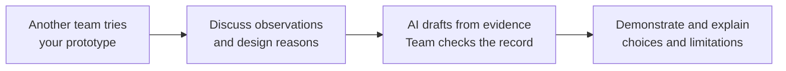

# Session 6 — Peer Testing, Documentation and Defence

[Course home](../../README.md) · [Sessions](../README.md) · [Previous session](../05-ai-assisted-development-and-git-workflow/README.md)

**135 minutes in three 45-minute blocks · Practical group work and discussion · Working language: English**

Let another team use your prototype, discuss why its design has changed, and turn your course evidence into a short project record. Use AI to organise and draft the documentation, then check it against your notes, code and physical build. Finish with a brief defence rehearsal.

## By the end you can

- test another team's solution without being taught its controls;
- distinguish observed behaviour, interpretation and proposed improvement;
- explain a design change through the user need, evidence, alternatives and trade-off;
- use an AI agent to document the main steps of your project across Sessions 1–6 without inventing missing evidence;
- produce a hardware record and a bill of materials (BOM) that describe the same physical build;
- identify the tested server version, uploaded firmware source and hardware revision;
- present the prototype's strengths, limitations and next useful test.

## Bring to class

Bring your working Pi/Arduino prototype, group GitHub repository and development computer with the graphical Antigravity app. Bring the evidence you already have: early concept and prototype images, architecture/state diagrams, Wizard-of-Oz notes, calibration or RFID records, Session 5 change cards, prompts and test results. Existing notes in another workspace are useful; export or copy only the relevant, anonymised material.

Prepare the working version before testing. If you need a GitHub update on the Pi, use the [Session 5 update sequence](../05-ai-assisted-development-and-git-workflow/activities/04-publish-update-and-test.md): desktop Wi-Fi menu → **TLU** → pull → restore the existing **ifi-lab** group hotspot → start the server. There is no Ethernet internet connection. Keep Arduino on its existing **IFI7386-G1/G2** network. Firmware uploads still happen over USB from the development computer.

## From testing to a defensible project record

During the peer test, let the participant act before explaining your design. Discuss the reasons afterwards. Peer testing provides useful classroom evidence; it does not establish that the solution works for every intended user.

## Session route

The opening and final handover take five minutes each. Activity times on the linked pages complete the three blocks below.

| Block | Activity | Checkpoint |
|---|---|---|
| 1 — Try each other's solutions | Opening; [01 — Prepare and cross-test](activities/01-prepare-and-cross-test.md) | Both teams have hosted and tested; each has a versioned record with at least three observations. |
| 2 — Explain and document | [02 — Discuss design decisions](activities/02-discuss-design-decisions.md); [03 — Document the project with AI](activities/03-document-the-project-with-ai.md) | Two explained design changes, one decision from today's test, and a checked draft covering Sessions 1–6. |
| 3 — Record the build and rehearse | [04 — Hardware and BOM](activities/04-hardware-and-bom.md); [05 — Defence rehearsal](activities/05-defence-rehearsal.md); final handover | Hardware record, matching BOM, reviewed documentation on GitHub and a short list of gaps before the defence. |

Use one documentation writer and a second person to check facts. Other members inspect the build, find earlier evidence and prepare the demonstration. Rotate speakers so that each member explains part of the work. Keep the Session 5 one-writer Git workflow.

## Keep the documentation small

Create these in **your team's existing repository**, alongside the code:

| File | Purpose | Starting point |
|---|---|---|
| `README.md` | What the prototype does, how to start it, links to the records below | Improve your existing README; preserve working startup instructions. |
| `docs/project-record.md` | Course milestones, design reasons, peer-test evidence and remaining questions | [Project record template](templates/project-record.md) |
| `docs/hardware.md` | Actual components, wiring, power, mounting, calibration and version record | [Hardware template](templates/hardware.md) |
| `docs/bom.csv` | Quantities and specifications of the physical parts and required equipment | [BOM template](templates/bom.csv) and [worked example](examples/library-hardware-and-bom.md) |

Link existing evidence rather than rewriting every note. Keep `docs/test-log.md` from Session 5 if you already use it; link it from the project record. A concise table and a few labelled images are enough. Record missing evidence as **MISSING**, an untested statement as **UNVERIFIED**, and a proposed change as **PLANNED**.

## Completion and work before the defence

Before leaving, open the pushed documentation on GitHub and check that links and images work. Keep the code commit tested on the Pi, firmware source uploaded to Arduino and hardware revision explicit; a later documentation commit does not mean the prototype was retested.

Assign an owner and next action to each important gap in the [defence checklist](activities/05-defence-rehearsal.md#short-defence-checklist). Implement only the improvements you choose to take forward, use the Session 5 delivery workflow, and retest after any code, calibration or wiring change. Preserve today's original observations.

The rehearsal format is practice guidance. Use the instructor's separately announced submission requirements, presentation length and assessment criteria for the actual defence.
