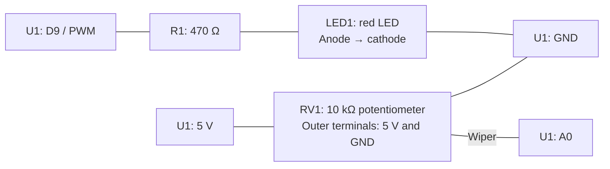

# Worked example — Document an exhibition light box

[Session 6](../README.md) · [Hardware activity](../activities/04-hardware-and-bom.md) · [Example BOM CSV](exhibit-light-bom.csv)

This **fictional teaching example** is a small exhibition light box: a visitor turns a knob to adjust an LED's brightness. It uses an Arduino UNO R4 WiFi, a potentiometer and one LED. Use its documentation method for your own team's project. You do not need to build this example during the session.

## 1. Turn source notes into a hardware record

Example source notes for an AI prompt:

```text
Teaching design only; no physical inspection or test has been performed.
U1 is one Arduino UNO R4 WiFi, powered through USB from DEV1, a laptop.
RV1 is one 10 kΩ linear potentiometer; manufacturer/model is UNVERIFIED.
RV1's outer terminals connect to U1 5 V and GND; its wiper connects to A0.
U1 D9 connects through R1, a 470 Ω resistor, to LED1's anode.
LED1 is a red indicator LED; its cathode connects to U1 GND.
The intended firmware reads A0 and controls LED brightness using PWM on D9.
No sketch or uploaded firmware version is supplied for this teaching design.
B1 is one breadboard and C1 one USB data cable. W1 groups the jumper wires.
M1 groups the proposed light-box enclosure and knob-mounting materials.
Jumper count, enclosure materials, component models and prices are unknown.
```

Ask the agent to draft a connection table and BOM from those facts, marking unknowns explicitly. For a real build, check the draft against component labels, the actual sketch and the powered-off circuit. The physical verification steps below are a plan, not recorded test results.

### Simple connection diagram



Lines represent electrical connections, not the physical order of breadboard holes. Identify the potentiometer's wiper and LED polarity from the actual part. Arduino's [potentiometer input example](https://docs.arduino.cc/built-in-examples/analog/AnalogInput/) explains the input connection; its [PWM LED example](https://docs.arduino.cc/built-in-examples/analog/Fading/) explains brightness control. Check board pins against the [UNO R4 WiFi documentation](https://docs.arduino.cc/hardware/uno-r4-wifi/). The 470 Ω series resistor is the chosen value for this teaching design.

| Part IDs | Connections | Purpose |
|---|---|---|
| U1, RV1 | RV1 outer terminals → U1 5 V and GND; RV1 wiper → U1 A0 | Read the knob position |
| U1, R1, LED1 | U1 D9 → R1 → LED1 anode; LED1 cathode → U1 GND | Control LED brightness with a current-limiting resistor |
| U1, C1, DEV1 | USB data cable between laptop and Arduino | Power, programming and Serial checks |

The design intends a continuous brightness adjustment. Whether clockwise means brighter depends on the connections and firmware; verify the actual direction before labelling the knob.

## 2. Derive the BOM

The [example CSV](exhibit-light-bom.csv) uses the same part IDs as the diagram. Its `role` distinguishes prototype parts from equipment used to develop and demonstrate it.

| ID | Item | Quantity in this design | Missing information |
|---|---|---|---|
| U1 | Arduino UNO R4 WiFi | 1 | Confirm the board in an actual build |
| RV1 | 10 kΩ linear potentiometer | 1 | Model, terminal identification and mounting |
| LED1 | Red indicator LED | 1 | Model, ratings and polarity |
| R1 | 470 Ω resistor | 1 | Actual value and tolerance |
| B1 | Breadboard | 1 | Size and connection layout |
| C1 | USB data cable | 1 | Laptop connector and cable length |
| W1 | Jumper wires | COUNT ON BUILD | Quantity, lengths and connector types |
| M1 | Enclosure and mounting materials | COUNT ON BUILD | Materials and quantities; split into separate rows |
| DEV1 | Laptop and its power equipment | 1 setup | Actual equipment and loan status |

This light box works locally on Arduino; its design does not call for a Pi or network. For your own group's BOM, identify the equipment **your** demonstration requires, including any server, power supply, storage, display and cables. Record borrowed equipment too. Software and libraries belong in the README/hardware record rather than the physical BOM.

CSV columns are `id`, `item`, `quantity`, `unit`, `specification`, `role`, `source_or_evidence`, `unit_price_eur` and `status`. Empty quantities or prices mean **unknown**, explained in `status`; they do not mean zero. This design inventory remains incomplete until a real build is inspected.

Matching part IDs and a separate parts list make the documentation easier to follow; see [OSHWA's BOM guidance](https://oshwa.org/resources/sharing-best-practices/).

## 3. Plan the verification

1. With power disconnected, check the actual parts, potentiometer terminals, LED polarity, series resistor, connections and jumper count.
2. Record the actual sketch/source version, uploaded firmware version and hardware revision. The design notes alone cannot establish these.
3. With suitable firmware installed, try minimum, middle and maximum knob positions. Record the expected and actual brightness, adjustment direction and any flicker or confusing feedback.
4. Ask a participant to make the light brighter without showing them how. Record their first action and any help needed. Keep technical operation separate from whether the control is understandable.

**Example verification status: NOT RUN.** These are proposed checks for the fictional light box. Your team writes and performs the checks relevant to its own project.
