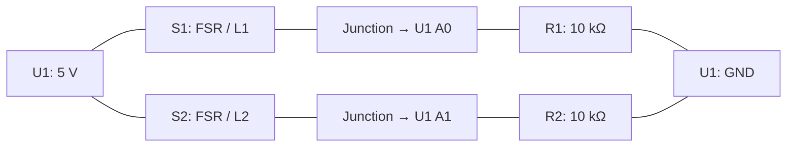

# Worked example — Document two library-chair sensors

[Session 6](../README.md) · [Hardware activity](../activities/04-hardware-and-bom.md) · [Example BOM CSV](library-bom.csv)

This is a **documentation example based on the supplied Session 4 library design**, not an inspection or test report for your team's build. Check it against your actual components and modifications. The [original wiring guide](../../04-integration-and-collaborative-development/group-1-library.md#parts-and-wiring) and [network sketch](../../04-integration-and-collaborative-development/examples/group-1-library/library/library.ino) supply the known circuit facts.

## 1. Turn checked notes into a hardware record

Example source notes for an AI prompt:

```text
Design reference only; physical inspection and testing have not been done here.
U1 is one Arduino UNO R4 WiFi. S1 and S2 are two FSRs; exact models unknown.
S1 maps to L1/A0 and S2 to L2/A1. Each has its own 10 kΩ resistor, R1/R2.
For each sensor: 5 V → FSR → measurement junction → resistor → GND.
Connect A0/A1 to the respective junction. Grounds are common.
U1 uses a USB data cable. A breadboard and jumper wires are needed.
Jumper count, resistor tolerance, mounting details and sensor models need inspection.
The Pi 400 runs the Node server; its browser shows the seat feedback.
No actual prices, calibration measurements or uploaded firmware version are supplied.
```

Ask the agent to draft the wiring table and BOM from those facts, leaving the unknowns visible. Check the result against the guide and then the powered-off build.

### Simple connection diagram



Lines represent electrical connections, not the physical order of breadboard holes. The measurement pin connects to the junction between its FSR and resistor. This example is for the **UNO R4 WiFi** and its 5 V circuit; check the [board documentation and pinout](https://docs.arduino.cc/hardware/uno-r4-wifi/) when identifying pins.

| Part IDs | Connections | Purpose |
|---|---|---|
| U1, S1, R1 | U1 5 V → S1; S1's other lead → U1 A0 and R1; R1's other lead → U1 GND | L1 voltage divider |
| U1, S2, R2 | U1 5 V → S2; S2's other lead → U1 A1 and R2; R2's other lead → U1 GND | L2 voltage divider |
| U1, C1 | USB data cable to the development computer during upload/Serial checks; record actual test power source | Power/programming connection |

Pressure decreases FSR resistance and raises the measured value in this arrangement. The sketch uses separate ON/OFF thresholds for each chair. Its default **ON 550 / OFF 400** values are examples, not calibration evidence. Replace them with your measured values and record the mounting; finger pressure alone is not a final chair calibration.

## 2. Derive the BOM

The [example CSV](library-bom.csv) has one row per labelled part or counted batch. Its `role` separates **prototype** parts from **demonstration equipment**. Add the actual labelled photos, verified model numbers and counts in your own copy.

| IDs | Item | Quantity in the reference design | Still to verify on the actual build |
|---|---|---|---|
| U1 | Arduino UNO R4 WiFi | 1 | Actual board identity |
| S1, S2 | FSR | 2, one per ID | Manufacturer/model and mounting |
| R1, R2 | Resistor | 2, one per ID, each 10 kΩ | Value and tolerance |
| B1 | Breadboard | 1 | Size and actual connection layout |
| C1 | USB data cable for UNO | 1 | Connectors and actual power source |
| W1 | Jumper wires | COUNT ON BUILD | Quantity, lengths and connector types |
| M1 | Pads/fasteners/mounting materials | COUNT ON BUILD | Actual materials and quantities; split into separate rows |

Also count the **Pi 400, its suitable power supply, OS storage, monitor, display cable, mouse and development computer** as required demonstration equipment. The Pi keyboard is built in; use the [Pi 400 specifications](https://www.raspberrypi.com/products/raspberry-pi-400/specifications/) to identify its connections. Record borrowed equipment as borrowed, with price unknown unless you have a real cost source. Software and libraries belong in the README/hardware record, outside the physical BOM.

CSV columns are `id`, `item`, `quantity`, `unit`, `specification`, `role`, `source_or_evidence`, `unit_price_eur` and `status`. Empty quantities or prices mean **unknown**, explained in `status`; they do not mean zero. The CSV is intentionally incomplete until inspected. Do not present it as a finished purchase list or total budget.

Matching part IDs and a separate parts list make it easier to relate the build instructions to the items needed; this follows [OSHWA's BOM guidance](https://oshwa.org/resources/sharing-best-practices/).

## 3. Verify the record

1. With power disconnected, match labels, resistor values, pin connections and wire count to the physical build. Inspect mounting without rewiring the circuit.
2. Record the actual empty and occupied readings for **each** mounted chair, its ON/OFF settings, hardware revision and source version.
3. Power the existing setup, run the Pi server on the restored group hotspot, and check L1, L2, both together, release, board disconnection for more than ten seconds, and recovery. Record results rather than copying PASS from an example.
4. Confirm the report's limits: a bag may look occupied; decorative chairs have no measured availability; a disconnected FSR wire can look free; USB disconnection only tests loss of board reports.

**Example verification status: NOT RUN.** The circuit and code references support the documentation draft; only your team's checks can establish whether your actual build matches and works.
